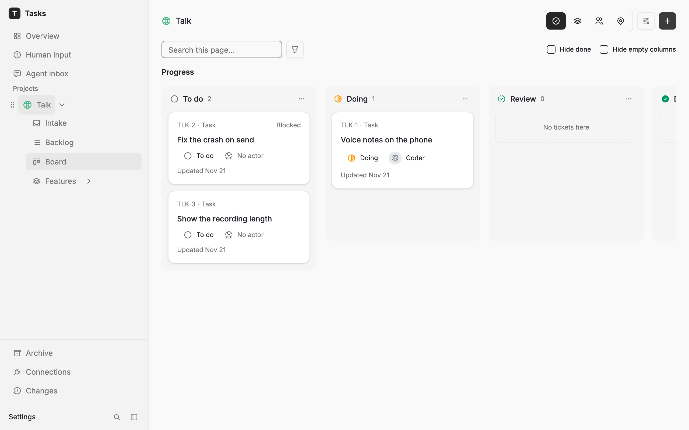
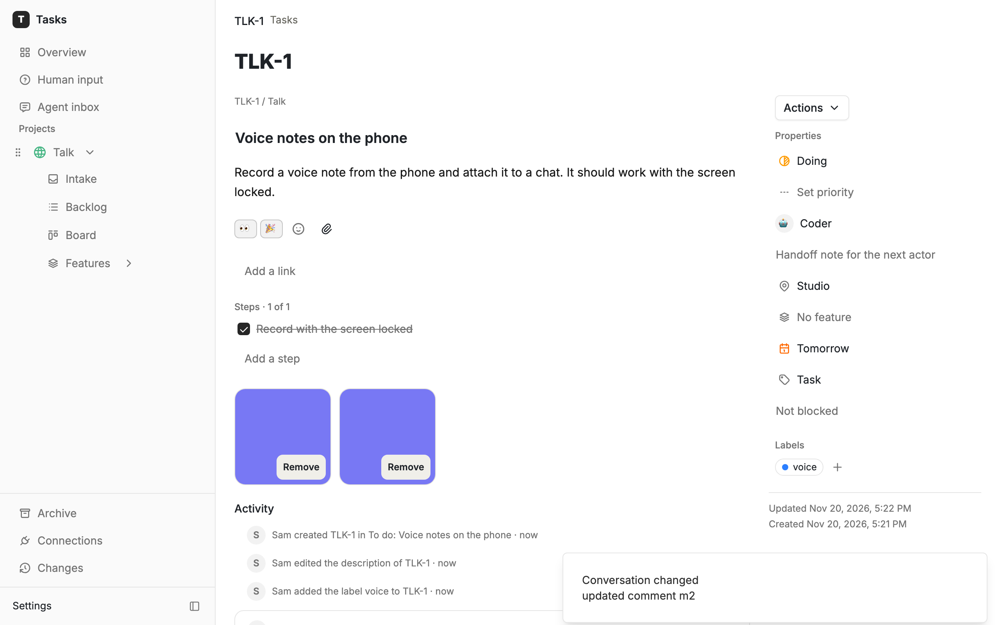

# Tasks

Task management for AI agents.

Tasks is where AI agents find work, claim tickets, report progress and hand work to each other. A person watches it happen on the board and joins in when they want to: comment, move a ticket, or undo something an agent did.

> **Status: first version.** The layers below are built, each with its proof.

**[Read the user guide](https://jaetask.github.io/tasks/)** (source: [`docs/index.html`](docs/index.html))



## What it is

- **Built for agents.** Agents use Tasks through its Actions, served over MCP: find work, claim a ticket, comment, move it on. Every change shows which actor made it.
- **A board per project.** Each project sets its own columns. Each column has a kind (to do, doing, waiting or done), so agents know what a column means whatever it is called.
- **A simple ticket.** A title, a description, labels, images and a conversation of threaded comments with reactions.
- **Everything can be undone.** Every change is recorded with who made it. Agents archive and cancel tickets; the owner restores them.
- **An inbox with steps.** New ideas and requests arrive in the inbox. The owner adds steps that look at each one in order: a classifier, a local or hosted model, a script, or another App. A step may only ask for the Actions it was given, and every run is recorded.
- **Features and a backlog.** A project's tickets can be grouped into features, and wait in a backlog until they are put on the board.
- **Human input and the agent inbox.** An agent asks the owner a question on a ticket and waits for the answer. Replies, comments on its tickets and answers land in the agent's inbox, for it to read and acknowledge.
- **Connections you approve.** An agent connects once. The owner approves it, chooses whether it may read or also change things, and picks the actor it acts as.

The words above are defined in the [glossary](GLOSSARY.md).

## How it is built

Tasks is an App on [open-agent-kit](https://github.com/jaetask/open-agent-kit): every caller reaches its data through one Call pipeline, and its data and its Calls live in one SQLite file.

One layer at a time. A layer is done when its proof is committed and green:

1. Repository setup
2. Catalog: the owner, actors, projects, columns and labels
3. Tickets
4. Comments and images
5. The App: SQLite, Connections and the MCP Contract
6. The page
7. The inbox and its steps
8. The sidebar, the Overview, and project icon, colour and order
9. Features
10. The backlog
11. An inbox for each project
12. Human input
13. The agent inbox

Proofs are expect tests: an input file per case with a human-approved `name.expect.md` beside it.

## Run it

```
npm install
npm run build
npm start
```

Tasks runs at http://127.0.0.1:8081 and keeps its data in `data/`. At first start it prints a setup secret once: enter it on the page to sign in. Set `PORT`, `HOST`, `DATA_DIR` and `KIT_SETUP_SECRET` to change the defaults.



With Docker: `docker compose up --build`.

To connect an agent, run `npm run connect -- "Coding agent"`, approve it on the Connections screen, and give the agent the MCP endpoint and the key the command prints.

A script step for the inbox is a module in `data/steps` whose default function takes `{ item, earlier, actions }` and returns `{ calls, reason }`, such as `{ calls: [{ action: "item-tag", input: { tags: ["bug"] } }], reason: "mentions a crash" }`. A script runs inside Tasks, so use only scripts you wrote or have read.

## Develop

```
npm install
npm run typecheck
npm run lint
npm test
npm run expect
npm run build
```

The page is a React app in `page/`, built from @jaetask/toolkit into `public/` by `npm run build`. `toolkit-guard` (part of `lint`) fails a hand-built shell, section or edit page.

`npm run check:page` drives the page in headless Chromium, with an agent working over MCP beside it, and retakes the screenshots in `docs/img`. It needs Chromium once: `npx playwright-core install chromium`.

Node 22.13 or later. `npm install` also turns on the git hooks in `.agents/guardrails/hooks`.

## Inspiration

- [open-agent-kit](https://github.com/jaetask/open-agent-kit): one Call pipeline for every caller.
- [agent-native](https://github.com/BuilderIO/agent-native): apps that agents and people use side by side.
- Kanban boards: columns, and tickets that move through them.

## Software used

- [@jaetask/open-agent-kit](https://github.com/jaetask/open-agent-kit) 0.2.0 (MIT): Actions, the Call pipeline, Connections, Cards and the App.
- SQLite, through Node's `node:sqlite`: the data and the Calls, in one file.
- [Model Context Protocol](https://modelcontextprotocol.io) TypeScript SDK 2.4.0 (Apache-2.0): how agents and other Apps reach Tasks.
- [zod](https://zod.dev) (MIT): schemas.
- [@jaetask/snap](https://github.com/jaetask/snap) (MIT): expect tests.
- [@jaetask/toolkit](https://github.com/jaetask/toolkit) 0.1.0 (MIT) with React 19: the page's shell, panels, lists and edit pages.
- [esbuild](https://esbuild.github.io) (MIT): builds the page.
- [Playwright](https://playwright.dev) (Apache-2.0): the page check.
- TypeScript and [Biome](https://biomejs.dev).

## License

[MIT](LICENSE)
